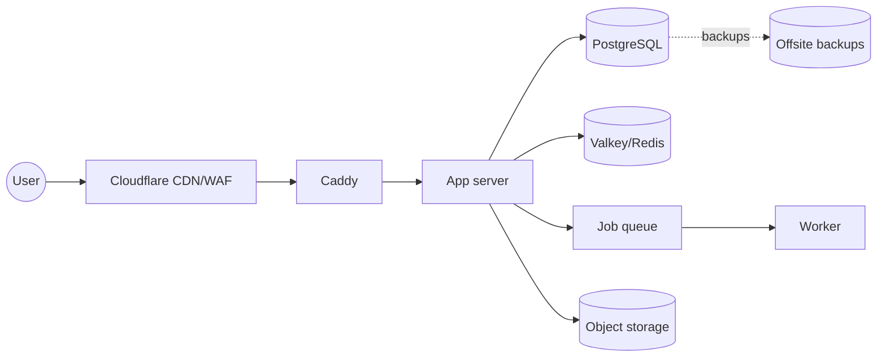

# Stack Decision Record: {{Project name}}

**Date:** {{YYYY-MM-DD}} · **Author:** {{name}} · **Status:** Proposed / Accepted

## 1. Summary
{{One paragraph: what is being built, for whom, and the core goal.}}

**Archetype(s):** {{e.g., Web app with login + landing page}}

**Assumptions made:** {{list anything inferred rather than confirmed}}

## 2. Requirements snapshot
| Dimension | Answer |
|---|---|
| Users | {{public / customers / staff; expected year-1 count}} |
| Auth | {{methods, roles, orgs, SSO}} |
| Data shape | {{relational / time series / files / vectors}} |
| Realtime | {{none / SSE / WebSockets / collab}} |
| SEO | {{needed? which pages}} |
| Platforms | {{web / iOS / Android / desktop}} |
| Scale target | {{requests/sec, data size}} |
| Compliance / residency | {{e.g., UAE PDPL, in-country hosting}} |
| Budget / ops appetite | {{e.g., <$50/mo, comfortable with VPS}} |
| Timeline | {{e.g., MVP in 4 weeks}} |
| RPO / RTO | {{e.g., 15 min / 4 h}} |

## 3. The stack
| Layer | Choice | Why | Alternative (switch if...) |
|---|---|---|---|
| Frontend framework | | | |
| UI / styling | | | |
| State / data fetching / forms | | | |
| Backend / API | | | |
| Language / runtime | | | |
| Database | | | |
| ORM / migrations | | | |
| Cache | | | |
| Background jobs | | | |
| Search | | | |
| File storage | | | |
| Auth | | | |
| Authorization | | | |
| Email | | | |
| Payments | | | |
| Realtime | | | |
| AI / LLM | | | |
| Hosting | | | |
| Reverse proxy / CDN / DNS | | | |
| CI/CD | | | |
| Secrets | | | |
| Backups | | | |
| Monitoring / logging | | | |
| Analytics | | | |
| Testing | | | |

(Write "Not needed" for layers that don't apply, so the omission is deliberate.)

## 4. Architecture


## 5. Folder structure
```
{{tree}}
```

## 6. Environment variables
| Key | Purpose | Where stored |
|---|---|---|
| DATABASE_URL | Postgres connection | Secret manager / .env on server |
| ... | | |

## 7. Backup and disaster recovery
- Database: {{method, frequency, PITR, destination, encryption}}
- Files: {{method}}
- Retention: {{policy}}
- Restore test: {{schedule}}
- Runbook location: {{RESTORE.md}}

## 8. Security checklist
- [ ] HTTPS + HSTS, Cloudflare Full (strict)
- [ ] DB/Redis not publicly reachable
- [ ] Auth library, MFA for admins, rate-limited auth endpoints
- [ ] Server-side authorization on every action
- [ ] Secrets in secret manager; none in git or client bundles
- [ ] Security headers + CSP
- [ ] Dependency updates automated; lockfiles committed
- [ ] Backups encrypted, offsite, tested
- [ ] Monitoring and alerts live
- [ ] {{project-specific items}}

## 9. Cost estimate (monthly)
| Item | Cost |
|---|---|
| | |
| **Total** | |

## 10. Scaling path
- **At 10x:** {{what changes}}
- **At 100x:** {{what changes}}

## 11. Risks and open questions
- {{risk / question → mitigation / owner}}

## 12. First-week build plan
1. {{Day 1: scaffold, repo, CI, deploy hello world to production}}
2. {{...}}
