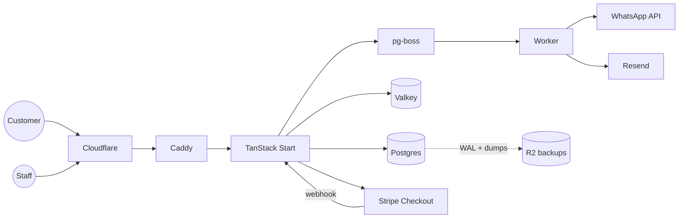

# Example: Booking SaaS for Car Wash Businesses

> **Prompt:** "I want to build a booking system for car wash businesses. Customers book a slot, pay online and get WhatsApp reminders. Each business has staff accounts. Solo developer, budget under $50/month, users in the UAE."

---

# Stack Decision Record: WashBook

**Date:** 2026-10-31 · **Status:** Proposed

## 1. Summary
A multi-tenant booking SaaS. Car wash businesses (tenants) manage branches, services, slots and staff. Their customers book and pay online and get WhatsApp reminders.

**Archetypes:** Multi-tenant B2B SaaS + booking system + public booking pages.

**Assumptions:** fewer than 50 businesses and 20k bookings/month in year 1; Arabic + English; no native mobile app at launch (responsive web).

## 2. Requirements snapshot
| Dimension | Answer |
|---|---|
| Users | Business owners/staff (login) + customers (guest checkout or phone OTP) |
| Auth | Email/password + Google for staff; phone OTP for customers; roles: owner, manager, staff |
| Data shape | Relational: tenants, branches, services, slots, bookings, payments |
| Realtime | Live slot availability on the staff dashboard (SSE) |
| SEO | Public booking pages per business should be indexable |
| Compliance | UAE PDPL; card data handled only by payment provider |
| Budget | < $50/month |
| RPO / RTO | 15 min / 4 h |

## 3. The stack
| Layer | Choice | Why | Alternative (switch if...) |
|---|---|---|---|
| Frontend | TanStack Start + Tailwind + shadcn/ui | Type-safe routing, SSR for public booking pages, server functions remove a separate API | Next.js if hiring React devs who only know Next |
| Forms/validation | TanStack Form + Zod | Shared schemas client and server | React Hook Form |
| Database | PostgreSQL 17 on the same VPS | Relational data; exclusion constraints prevent double booking; ~1 ms latency | Neon (same region) if you want managed |
| ORM | Drizzle + drizzle-kit migrations | Lightweight, SQL-like, great types | Prisma |
| Double-booking guard | `tstzrange` + `EXCLUDE USING gist` | Database guarantees no overlapping bookings per bay | App-level locks (weaker) |
| Cache / rate limits | Valkey | Slot availability cache, OTP and login rate limits | Skip at first; Postgres only |
| Background jobs | pg-boss | Reminders, emails, webhooks without extra infra | BullMQ on Valkey |
| Auth | Better Auth (organization + phone-number plugins) | Users in our DB, orgs = tenants, roles built in | Clerk if you want hosted UI |
| Tenant isolation | `tenant_id` on every table + Postgres RLS | Defense in depth | Schema per tenant |
| Payments | Stripe Checkout (or a UAE gateway such as Network International/Tap) | Hosted checkout keeps PCI scope minimal | Telr, PayTabs |
| WhatsApp/SMS | WhatsApp Business Cloud API via a provider (Twilio/Unifonic) | Reminders customers actually read | SMS only |
| Email | Resend + React Email | Simple, good deliverability | Postmark |
| Hosting | 1 VPS (4 vCPU, 8 GB) + Docker Compose + Caddy | Cheapest, fastest (DB colocated) | Railway if no ops time |
| CDN/DNS/WAF | Cloudflare (Full strict, WAF, Turnstile) | Free tier covers it | — |
| CI/CD | GitHub Actions → GHCR → SSH deploy | Simple, repeatable | Coolify |
| Backups | pgBackRest to Cloudflare R2 (WAL archiving) + nightly pg_dump | PITR within minutes | WAL-G |
| Monitoring | Sentry + Uptime Kuma (separate small server) + Healthchecks.io | Errors, uptime, backup heartbeats | Better Stack |
| i18n | Paraglide JS, RTL via Tailwind logical utilities | Tiny bundles, Arabic-ready | i18next |

## 4. Architecture


## 5. Folder structure
```
washbook/
├── src/
│   ├── routes/            # public booking pages + dashboard
│   ├── server/            # server functions, services
│   ├── db/schema.ts       # Drizzle schema
│   └── jobs/              # reminders, emails
├── drizzle/               # migrations
├── docker-compose.yml
├── Caddyfile
└── .github/workflows/deploy.yml
```

## 6. Environment variables
`DATABASE_URL`, `VALKEY_URL`, `BETTER_AUTH_SECRET`, `GOOGLE_CLIENT_ID/SECRET`, `STRIPE_SECRET_KEY`, `STRIPE_WEBHOOK_SECRET`, `WHATSAPP_API_TOKEN`, `RESEND_API_KEY`, `SENTRY_DSN`, `R2_*` (backup, write-only key).

## 7. Backup and disaster recovery
pgBackRest: weekly full, daily incremental, continuous WAL to R2 (encrypted). Nightly `pg_dump` to a second bucket. Retention 7 daily / 4 weekly / 12 monthly. Monthly automated restore test. `RESTORE.md` in repo.

## 8. Security checklist
Server-side tenant checks on every server function · RLS enabled · OTP and login rate-limited · Turnstile on public booking form · Stripe webhooks verified and idempotent · MFA for owners · DB port never public.

## 9. Cost estimate (monthly)
| Item | Cost |
|---|---|
| VPS 4 vCPU / 8 GB | ~$15–25 |
| Small uptime-monitor VPS | ~$5 |
| Cloudflare + R2 (backups) | ~$1–3 |
| Resend (free tier) | $0 |
| WhatsApp messages | usage-based |
| **Total fixed** | **~$25–35** |

## 10. Scaling path
- **10x:** bigger VPS, move Postgres to its own server on a private network, PgBouncer.
- **100x:** two app servers behind a load balancer, Postgres replica with failover, dedicated worker server.

## 11. Risks
WhatsApp template approval delays → start with SMS fallback. Time zones are fine (UAE has no DST), but store `timestamptz` anyway for future regions.

## 12. First-week plan
1. Scaffold TanStack Start, Drizzle, Better Auth; deploy hello world to the VPS via CI.
2. Tenants, branches, services schema + RLS.
3. Slot engine with exclusion constraint + tests.
4. Public booking page + Stripe Checkout + webhook.
5. Reminder jobs + backups + monitoring.
