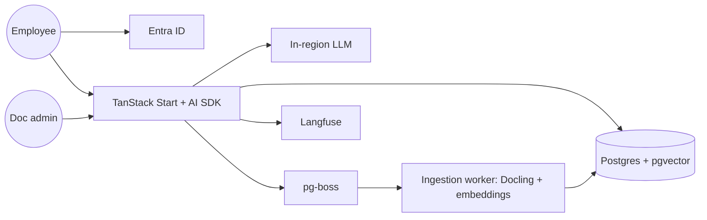

# Example: Internal Policy Assistant (RAG Chatbot)

> **Prompt:** "Build a chatbot that answers employee questions from our 2,000 internal policy PDFs, in Arabic and English. Staff sign in with Microsoft accounts. Data must stay in the UAE."

---

# Stack Decision Record: Policy Assistant

**Date:** 2026-10-31 · **Status:** Proposed

## 1. Summary
An internal AI assistant that answers questions from company policy documents with citations, behind company SSO, hosted in-country.

**Archetypes:** LLM / RAG app + internal tool + enterprise/government constraints.

**Assumptions:** ~500 employees, ~5k questions/month, documents updated weekly, an approved LLM provider or model is available in a UAE region.

## 2. Requirements snapshot
| Dimension | Answer |
|---|---|
| Users | Internal staff only |
| Auth | Microsoft Entra ID SSO (OIDC); admin role for document managers |
| Data | 2,000 PDFs → chunks + embeddings; chat history |
| Residency | Must stay in UAE → in-country cloud region or on-prem |
| Languages | Arabic (MSA) + English |
| Realtime | Token streaming (SSE) |
| RPO / RTO | 24 h / 1 day (documents are re-ingestable) |

## 3. The stack
| Layer | Choice | Why | Alternative (switch if...) |
|---|---|---|---|
| App | TanStack Start + Vercel AI SDK | Streaming chat UI and server functions in one TypeScript codebase | FastAPI + React if the team is Python-first |
| LLM | Provider model available in a UAE region (e.g., via Azure UAE North), or an open-weight model on in-country GPUs | Residency requirement drives this choice; benchmark Arabic quality first | Regional Arabic models (Jais, ALLaM) if they win your evals |
| Embeddings | Multilingual embedding model hosted in-region | Must handle Arabic and English in one vector space | Provider embeddings if residency allows |
| Database + vectors | PostgreSQL + pgvector (HNSW) | Vectors next to permissions and chat history; one system to back up | Qdrant if >10M chunks |
| Retrieval | Hybrid: Postgres full-text + vectors, then reranker | Better recall for policy names, numbers and Arabic terms | Vectors only (weaker) |
| Document parsing | Docling (self-hosted) in a worker | Handles tables and headings in PDFs, runs in-country | Azure Document Intelligence (in-region) |
| Ingestion jobs | pg-boss worker | Re-index changed PDFs weekly | Dagster if pipelines grow |
| Auth | Better Auth with Microsoft Entra ID (OIDC) | Company SSO, users in our DB | Direct MSAL integration |
| Hosting | Containers in a UAE cloud region (or on-prem Docker/OpenShift) | Data residency | — |
| Observability | Langfuse (self-hosted) + Sentry | Trace every prompt, cost and answer quality | Arize Phoenix |
| Evals | 150 real questions with expected answers, run in CI with Promptfoo | Prevents silent regressions when prompts or models change | Braintrust |
| Backups | Nightly encrypted pg_dump to in-country object storage | Chat history + config; docs re-ingestable | pgBackRest PITR if chats become critical |

## 4. Architecture

## 5. Key design rules
- Every answer cites the source document and section; the model says "not found in policies" when retrieval is weak.
- Chunks carry metadata (department, effective date, language) and access filters applied **before** retrieval.
- Treat document text as untrusted input: no tool calls or actions triggered by content inside documents.
- Per-user rate limits and a monthly token budget.

## 6. Cost estimate (monthly, rough)
Compute for app + Postgres: ~$50–150 in a UAE cloud region. LLM usage: depends on model; budget with evals (~5k questions × average tokens). GPUs are the big cost if self-hosting an open model.

## 7. Risks
Arabic retrieval quality → test chunking and embeddings on real Arabic questions in week 1. Outdated policies → show effective dates in answers and re-ingest on change.

## 8. First-week plan
1. Confirm approved LLM/region; run a 50-question Arabic/English bake-off.
2. Scaffold app, Entra ID login, Postgres + pgvector.
3. Ingestion pipeline for 100 sample PDFs.
4. Hybrid retrieval + citations + streaming UI.
5. Langfuse tracing + Promptfoo eval in CI.
